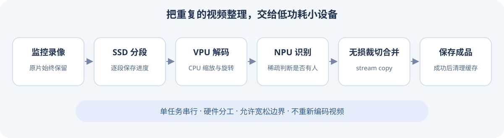
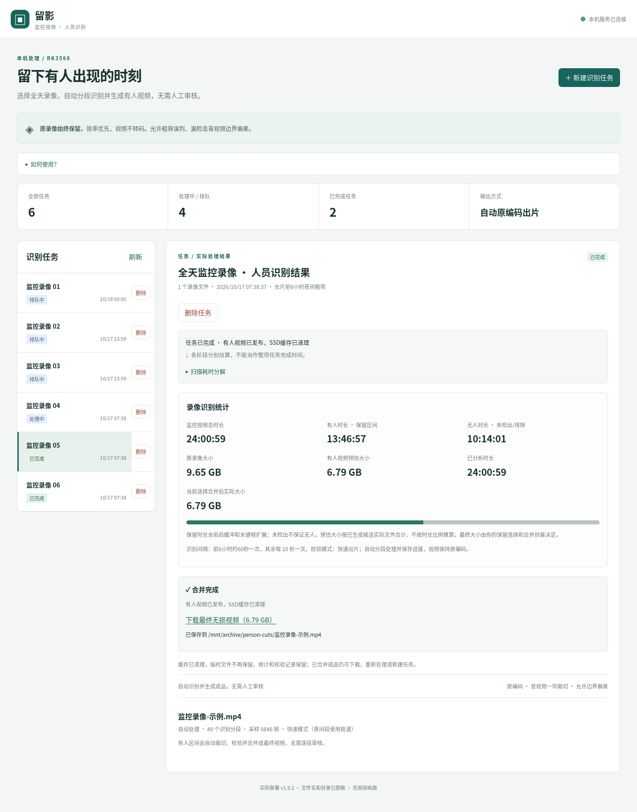
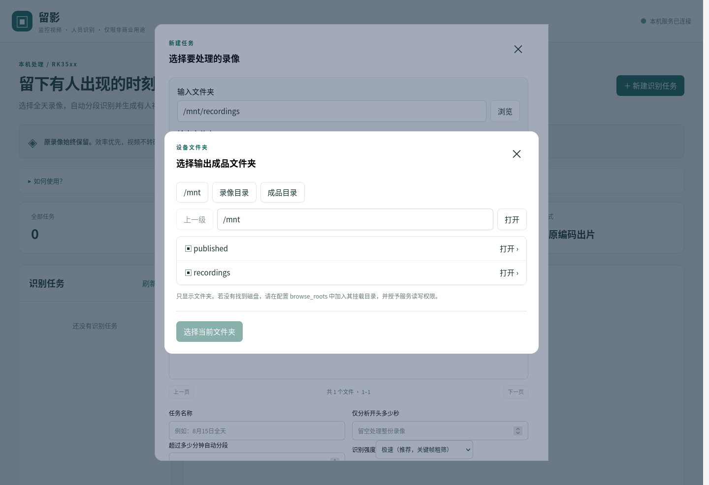

# RK35xx CCTV Person Cut

**监控视频人员识别与无损裁切 · 仅限非商业用途**

在 Rockchip Linux 设备上，从长时间监控录像中保留可能有人出现的区间，自动裁切、合并并保存成品。`CCTV` 表示监控视频；本项目做人员存在检测，不做人脸身份识别。

本仓库是以已部署的 v1.9.2 为基础整理的独立适配版，当前标记为 **2.0.0-dev**。原有 RK3568 部署环境已使用原处理链；本仓库及其他芯片的验证范围见 [兼容矩阵](docs/COMPATIBILITY.md)，不能把上游支持等同于本项目实机验收。

## 为什么选择 Rockchip RK35xx？

**希望用一台便宜、省电的小设备，持续整理监控录像。** RK35xx 将 CPU、视频处理和神经网络推理集成在一颗芯片中，适合家庭 NAS、闲置 ARM 盒子和轻量服务器。

| 考虑 | 对这个项目的实际意义 |
|---|---|
| 入手成本低 | 例如采用 RK3566 的网心云 OEC，作者看到过二手约 **100 多元**的设备，可以复用闲置盒子。此处是选型背景，价格随配置、成色和市场变化。 |
| 适合低功耗常开 | 小型 ARM 设备适合放在家中长期运行，不必为了定期裁切录像一直开着一台较大的电脑。整机功耗取决于板卡、硬盘、电源和负载，本项目未给各设备做统一功耗测量。 |
| 有专用 VPU 和 NPU | VPU 负责视频解码，NPU 负责人员识别，减少把这些工作全部交给 CPU 的负担；CPU 仍负责缩放、旋转、调度和文件读写。 |
| 原编码出片 | 最终裁切和合并使用 stream copy，不重新编码视频，省去重编码的时间和资源。 |

硬件分工以[瑞芯微 RK3568 官方简介](https://www.rock-chips.com/uploads/pdf/2022.8.26/192/RK3568%20Brief%20Datasheet.pdf)及[官方 RKNN 支持平台](https://github.com/airockchip/rknn-toolkit2)为依据。实际资源占用与处理速度还取决于分辨率、采样密度、硬盘吞吐及驱动组合；使用软件解码回退时，CPU 占用会增加。



## Web 面板预览



面板展示任务队列、有人区间、识别进度与成品下载。上图来自本机实际部署的任务面板，仅展示统计，没有视频画面；发布截图中的文件名及路径已替换为示例。



新建任务时浏览**运行设备上的输入、输出文件夹**，不需要把录像上传到浏览器。每个任务保存自己的目录，后续换目录不影响已有任务。上图为新仓库隔离环境中的目录选择界面，显示示例路径。

## 许可

Copyright (c) 2026 **andyfanybo**。

项目原创代码按 [PolyForm Noncommercial License 1.0.0](LICENSE) 提供，**商业用途不在授权范围内**。请保留许可证和 [NOTICE](NOTICE)。正式授权范围、非商业组织及其他例外以 LICENSE 为准。

这是限制商业用途的源码公开项目（source-available）。第三方依赖、模型和硬件运行库保留各自许可，见 [第三方说明](THIRD_PARTY_NOTICES.md)。仓库不附带录像、人物截图、模型权重或厂商二进制。

## 处理方式

- 单 worker、NPU 锁，按小段保存进度；恢复时沿用已完成识别。
- 默认关键帧约 30 秒粗筛。长于 6 小时且启用夜间宽松时，前 6 小时约 60 秒采样；使用相对录像时间。
- 视频和音频按同一区间 `-c copy`，保留原压缩编码，允许切点偏差。
- 自动保留检测区间，允许误检、漏检及多保留上下文；不要求人工逐段确认。
- 个别分段三次识别失败后整段保留并标注。模型、运行库及解码环境问题提前检查。
- SSD 工作目录与原片、发布目录分离。最终按原名发布，不覆盖同名文件；发布确认后释放重缓存。
- 取消、删除会停止 worker 进程组；删除保护原片和已发布成品。

## 初版支持范围

| 项目 | 当前范围 |
|---|---|
| 系统 | Linux ARM64，glibc，具有匹配的厂商 RKNPU 驱动 |
| 芯片目标 | RK3566 / RK3568 / RK3576 / RK3588；实测状态分别记录 |
| 新安装 Python | 建议 3.10–3.12；本机兼容检查在 3.7 环境进行 |
| NPU | RKNN C API；640×640 RGB、COCO80、Rockchip YOLOv8 九输出布局 |
| 录像 | 普通 MP4，单路 8-bit HEVC 视频＋单路 Opus 音频 |
| 解码 | `hevc_rkmpp` 或显式启用软件解码；可降级为连续解码采样 |
| 发布存储 | 支持硬链接、不覆盖创建的文件系统；挂载盘需配置挂载校验 |

其他编码、Main10、Android、32 位用户态、musl 和任意主线内核组合未纳入首版支持承诺。软件解码仅替代 VPU，人员推理仍使用 NPU。

## 一键安装（推荐）

准备一块 SSD 作为工作缓存盘，并确保系统有 Python 3.10+、venv、curl。先把下面的 `/mnt/ssd/cctv-person-work` 改成你的 SSD 专用目录。

中国大陆下载方式（GitHub 加速＋本次安装临时使用清华 PyPI 镜像）：

```bash
curl -fL --retry 2 'https://ghfast.top/https://raw.githubusercontent.com/andyfanybo/rk35xx-cctv-person-cut/main/install.sh' -o /tmp/rk35xx-install.sh && bash /tmp/rk35xx-install.sh --china --work-dir /mnt/ssd/cctv-person-work
```

GitHub 可直接访问时：

```bash
curl -fL --retry 2 'https://raw.githubusercontent.com/andyfanybo/rk35xx-cctv-person-cut/main/install.sh' -o /tmp/rk35xx-install.sh && bash /tmp/rk35xx-install.sh --work-dir /mnt/ssd/cctv-person-work
```

脚本下载源码、创建独立虚拟环境和配置、安装 Python 依赖并启动面板。无需手工 git clone，也保留源码安装方式。默认访问 `http://设备IP:8423`；端口可用 `--port` 修改。

**一键安装完成的是应用和 Web 面板。** 与芯片匹配的模型、FFmpeg 和 RKNN Runtime 仍需配置；脚本不替换板厂驱动、不分发未知来源权重。首次运行前在 Web 选择目录，再按[模型说明](docs/MODELS.md)和诊断结果补齐硬件环境。

`--github-proxy https://你的加速服务/` 可替换公共加速站；`--pip-index-url` 可自定义软件包镜像。只对公开源码下载使用加速，GitHub token 和仓库写入不经过这些镜像。公共站点可用性会变化，失败时可改用直连或自备镜像。完整参数、旧系统复用方式和启动停止见 [安装说明](docs/INSTALL.md)。

## 从源码安装

先安装与你的系统匹配的 FFmpeg、FFprobe 和 RKNN Runtime；应用不会自动修改内核驱动或系统库。

```bash
python3 -m venv .venv
. .venv/bin/activate
python -m pip install -r requirements.txt
cp config/config.example.json config/config.local.json
```

编辑 `config/config.local.json`，配置录像目录、SSD 工作目录、成品目录、模型和运行库。所有配置文件内的相对路径都相对于该配置文件。第一次使用时应选择短样本。

也可先配置 `browse_roots` 为挂载磁盘的根目录，之后在 Web 中选择每项任务的输入、输出位置；不再要求固定两个输入文件夹。

```bash
export PERSON_CONFIG="$PWD/config/config.local.json"
python doctor.py
python doctor.py --hardware --sample /path/to/short-hevc-opus.mp4 --storage-test
python server.py
```

默认界面地址：<http://127.0.0.1:8423>。更改 `bind` 可以允许局域网访问。服务保留任意 Origin 行为，不附带账户登录；按你的访问环境部署。

`doctor` 默认只查基本信息，**不加载模型、不访问 NPU、不写发布目录**。`--hardware` 和 `--storage-test` 分别明确启用短硬件测试及临时目录写入测试；只有完整诊断成功才报告 `ready_for_jobs: true`。硬件测试占用同一个 NPU 锁。

没有模型时界面仍可启动，实际识别任务会明确失败。模型准备见 [模型说明](docs/MODELS.md)。已经能运行的旧 Python 3.7 板厂环境可继续使用现有 NumPy/OpenCV，不要直接安装上述面向新环境的依赖文件。

## 配置与部署

详见 [配置说明](docs/CONFIGURATION.md)、[兼容矩阵](docs/COMPATIBILITY.md) 和 [systemd 示例](deploy/rk35xx-cctv-person-cut.service)。systemd 示例中的用户、设备组、目录和虚拟环境路径需要按设备修改。

业务入口：`server.py → launch_quick_pipeline.py → quick_pipeline.py → turbo_scan.py / pipeline.py → merge_export.py → publication.py`。公开版本只提供 quick 自动处理；旧的逐包校验、波形复核和历史批处理入口未迁入。

## 开发检查

```bash
python -m unittest discover -s tests -v
python tools/check_release.py
```

测试使用隔离临时文件和模拟硬件，不自动扫描真实录像或更改系统服务。GitHub Actions 配置提供 Python 3.10–3.12 的无硬件检查；只有实际跑过的结果才记入兼容矩阵。

本仓库工作目录为独立安装，不会自动导入其他部署的任务。模型、设置或输入发生变化时新建任务；跨机器搬迁不直接复用含绝对路径的生产 job.json。
